# 🔒 Zabbix — SNMP Security Lab 2174

**Laboratorio de Seguridad de Redes — Zabbix / Cisco IOS / GNS3**

> Implementación de una red local virtual con router Cisco como servidor DHCP, switch con IP de administración y monitoreo centralizado en Zabbix mediante SNMPv2c con comunidad de solo lectura.

---

## 🎬 Video de demostración

> **Video:** [Ver demostración en YouTube](https://www.youtube.com/watch?v=eFYzJglW71Y)

---

## 📑 Tabla de contenido

1. [Objetivo del laboratorio](#-objetivo-del-laboratorio)
2. [Cumplimiento de requisitos](#-cumplimiento-de-requisitos)
3. [Mapa interactivo de la red](#️-mapa-interactivo-de-la-red)
5. [Topología y direccionamiento](#️-topología-y-direccionamiento)
5. [Componentes del entorno](#-componentes-del-entorno)
6. [Funcionamiento de la configuración](#-funcionamiento-de-la-configuración)
7. [Configuración del router y DHCP](#-configuración-del-router-y-dhcp)
8. [Configuración del switch](#-configuración-del-switch)
9. [SNMP de solo lectura](#-snmp-de-solo-lectura)
10. [Servidor Zabbix](#-servidor-zabbix)
11. [Validación de la implementación](#-validación-de-la-implementación)
12. [Capturas de pantalla](#-capturas-de-pantalla)
13. [Archivos del repositorio](#-archivos-del-repositorio)
14. [Limitaciones observadas](#-limitaciones-observadas)
15. [Estado final del proyecto](#-estado-final-del-proyecto)

---

## 🎯 Objetivo del laboratorio

Demostrar el aprovisionamiento automático de direcciones IPv4 en una LAN de GNS3 y la consulta segura de información operativa del router y switch mediante una comunidad SNMP de solo lectura. El servidor Ubuntu utiliza DHCP y recopila los datos con Zabbix 7.4.

---

## ✅ Cumplimiento de requisitos

| Requisito | Implementación y evidencia |
|---|---|
| Router con IPv4 | `FastEthernet0/0` — `192.168.79.254/24` |
| Switch con IPv4 | `Vlan1` — `192.168.79.2/24` |
| DHCP para LAN | Pool Cisco `LAN-ZABBIX`, `192.168.79.100–200` |
| SNMP solo lectura | Comunidad `ZABBIX-RO` con opción `RO` en ambos equipos |
| Servidor Ubuntu cliente DHCP | `ens3`, DHCP; `192.168.79.101/24` observado |
| Verificación SNMP Router | Datos recientes de CPU, memoria, temperatura e interfaces |
| Verificación SNMP Switch | Estado, velocidad, tráfico e información de sistema |
| Documentación gráfica | Diagramas y capturas enlazadas en `images/` |
| Running-configs | `files/` |
| Configuraciones y comandos | `scripts/` |

---

## 🗺️ Topología y direccionamiento

La topología conecta R1-2174 con Switch-2174 y ZABBIX-SV-2174. Cloud1 enlaza el switch a VMnet1 para acceder al frontend desde Windows. NAT1 se utilizó temporalmente durante la instalación de paquetes y no forma parte del montaje final.

<p align="center">
  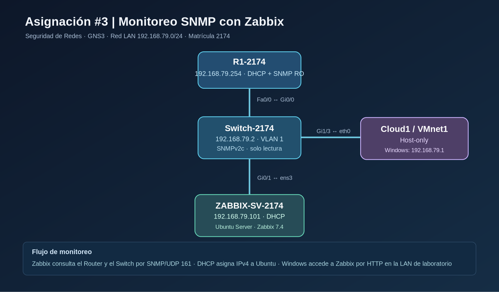
</p>

<p align="center">
  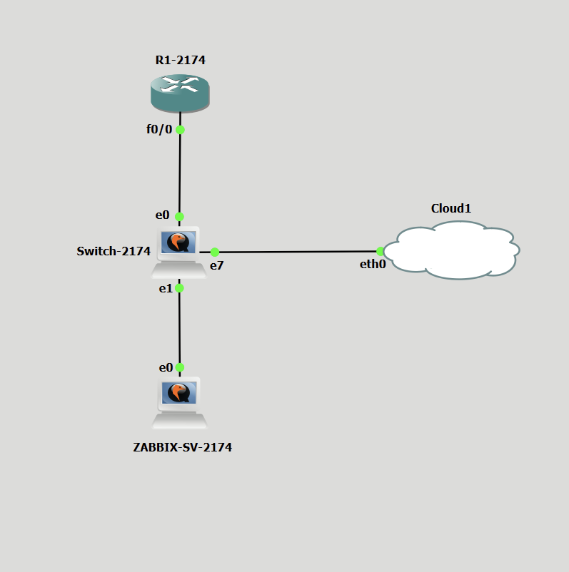
</p>

### 🖱️ Mapa interactivo de la topología

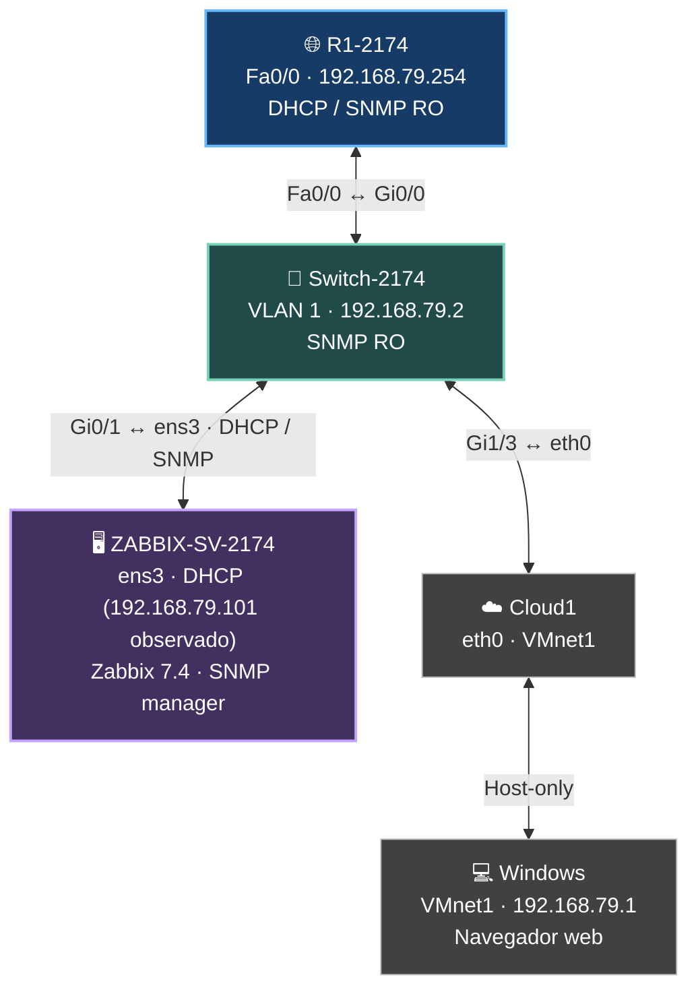

<details>
<summary><strong>🌐 Router R1-2174 — DHCP y agente SNMP</strong></summary>

- Dirección: `192.168.79.254/24` en `FastEthernet0/0`.
- Pool: `LAN-ZABBIX`; rango disponible `192.168.79.100–200`.
- Gateway entregado a los clientes: `192.168.79.254`.
- Comunidad: `ZABBIX-RO` con privilegio `RO`.
- Configuración completa: [R1-2174-running-config.txt](files/R1-2174-running-config.txt).

</details>

<details>
<summary><strong>🔀 Switch-2174 — administración y agente SNMP</strong></summary>

- Dirección de administración: `192.168.79.2/24` en `Vlan1`.
- `Gi0/0` hacia Router, `Gi0/1` hacia Ubuntu y `Gi1/3` hacia Cloud1.
- Gateway de administración: `192.168.79.254`.
- Comunidad: `ZABBIX-RO` con privilegio `RO`.
- Configuración completa: [Switch-2174-running-config.txt](files/Switch-2174-running-config.txt).

</details>

<details>
<summary><strong>🖥️ Servidor ZABBIX-SV-2174 — cliente DHCP y monitoreo</strong></summary>

- Ubuntu Server 26.04.1 LTS; interfaz `ens3` con `dhcp4: true`.
- Última dirección observada: `192.168.79.101/24` (dinámica).
- Zabbix 7.4 conectado al Router y al Switch mediante SNMPv2c.
- Evidencias: [cliente DHCP](images/08_ubuntu_cliente_dhcp.png), [Router SNMP](images/11_zabbix_router_datos_snmp.png) y [Switch SNMP](images/12_zabbix_switch_datos_snmp.png).

</details>

<details>
<summary><strong>☁️ Cloud1 y 💻 Windows — acceso al frontend</strong></summary>

- Cloud1 `eth0` conecta la red LAN virtual a `VMnet1` de VMware (Host-only).
- Windows utiliza `192.168.79.1/24` en VMnet1.
- URL local observada: `http://192.168.79.101/zabbix/` (sujeta a cambios DHCP).
- No requiere acceso a Internet para el monitoreo local.

</details>

### Tabla de direccionamiento

| Equipo | Interfaz | IP / red | Función |
|---|---|---|---|
| R1-2174 | FastEthernet0/0 | `192.168.79.254/24` | Gateway, DHCP y SNMP |
| Switch-2174 | VLAN 1 | `192.168.79.2/24` | Administración y SNMP |
| ZABBIX-SV-2174 | ens3 | `192.168.79.101/24` (dinámica observada) | Zabbix, cliente DHCP |
| PC Windows | VMnet1 | `192.168.79.1/24` | Acceso a frontend |
| LAN | — | `192.168.79.0/24` | Segmento de monitoreo |

---

## 🧩 Componentes del entorno

| Componente | Descripción |
|---|---|
| Emulador | GNS3 y GNS3 VM |
| Router | Cisco IOS, `R1-2174` |
| Switch | Cisco IOSv-L2, `Switch-2174` |
| Servidor | Ubuntu Server 26.04.1 LTS |
| Plataforma | Zabbix 7.4 con MySQL, Apache y PHP-FPM |
| Protocolo | SNMPv2c, consulta UDP/161 |
| Acceso web | Windows mediante VMware VMnet1 Host-only |

---

## 🔬 Funcionamiento de la configuración

### Asignación de direcciones
El router anuncia por DHCP la red `192.168.79.0/24`, la puerta de enlace `192.168.79.254` y DNS `8.8.8.8`. Se excluyen direcciones de administración para que el rango disponible sea `192.168.79.100–200`.

### Gestión del Switch
El Switch utiliza la VLAN 1 para administración y mantiene enlaces de acceso al Router, Ubuntu y Cloud. La dirección `192.168.79.2` permite al servidor consultar su agente SNMP.

### Monitoreo centralizado
Zabbix accede a los equipos por SNMPv2c a través de la LAN. La comunidad `ZABBIX-RO` se configuró con permiso `RO`, y la plantilla `Cisco IOS by SNMP` obtiene estadísticas y estados soportados por las imágenes virtuales.

---

## 🌐 Configuración del router y DHCP

```cisco
interface FastEthernet0/0
 ip address 192.168.79.254 255.255.255.0
 duplex full
!
ip dhcp excluded-address 192.168.79.1 192.168.79.99
ip dhcp excluded-address 192.168.79.201 192.168.79.254
ip dhcp pool LAN-ZABBIX
 network 192.168.79.0 255.255.255.0
 default-router 192.168.79.254
 dns-server 8.8.8.8
```

<p align="center">
  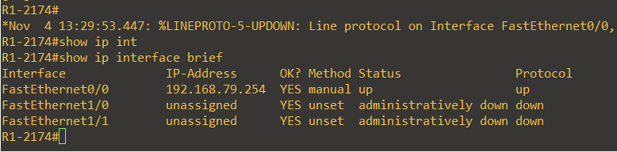
</p>
<p align="center">
  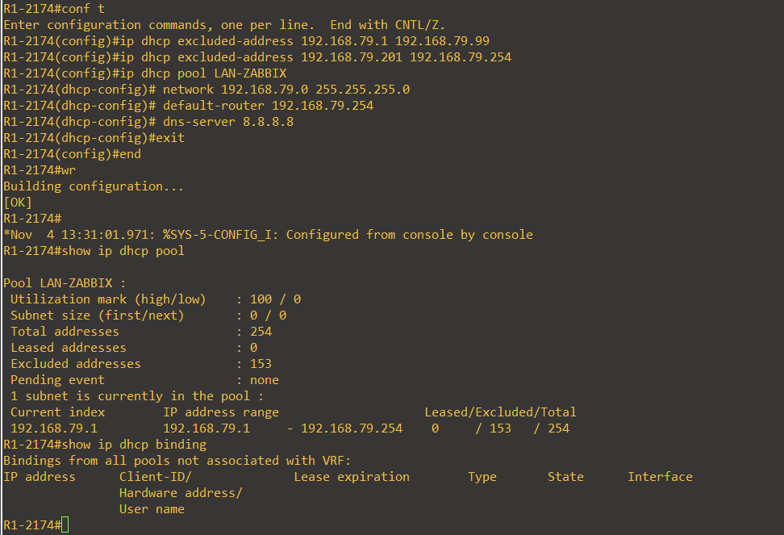
</p>

---

## 🔀 Configuración del switch

```cisco
interface Vlan1
 ip address 192.168.79.2 255.255.255.0
!
ip default-gateway 192.168.79.254
```

<p align="center">
  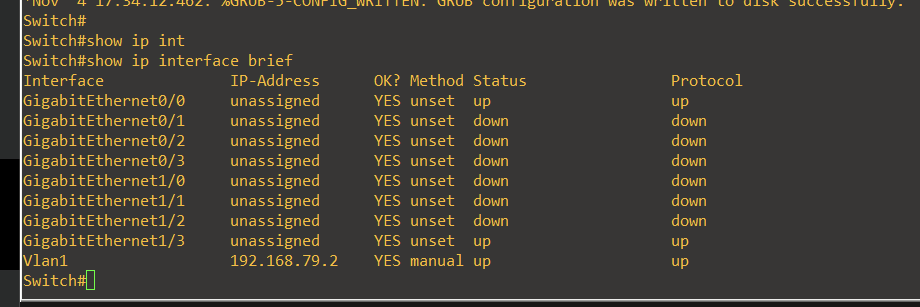
</p>

---

## 🔐 SNMP de solo lectura

En ambos equipos se configuraron las mismas instrucciones:

```cisco
snmp-server community ZABBIX-RO RO
snmp-server location LAB-GNS3
snmp-server contact ADMIN-2174
```

`RO` impide utilizar la comunidad para operaciones SNMP de escritura. En este entorno de laboratorio se usa SNMPv2c; sus comunidades no están cifradas y no deben reutilizarse en redes de producción.

### Router: comunidad de solo lectura
<p align="center">
  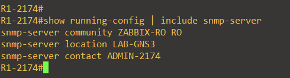
</p>
<p align="center">
  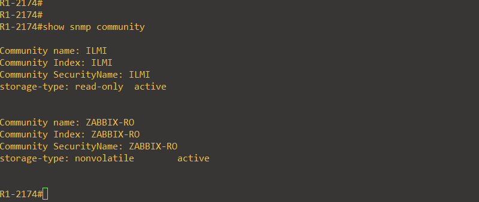
</p>

### Switch: comunidad de solo lectura
<p align="center">
  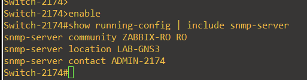
</p>
<p align="center">
  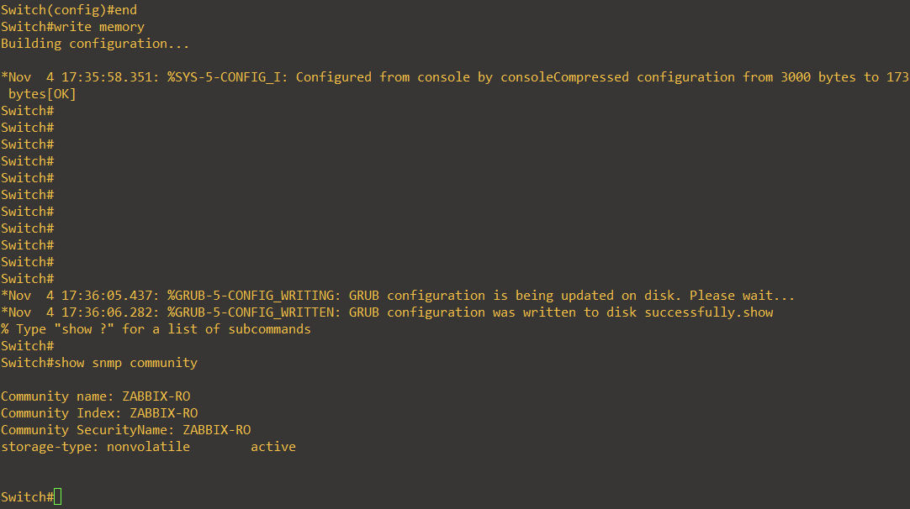
</p>

---

## 🖥️ Servidor Zabbix

Ubuntu administra la interfaz `ens3` por Netplan con `dhcp4: true`. La última dirección observada fue `192.168.79.101/24`, con gateway `192.168.79.254`. La dirección puede cambiar en renovaciones posteriores por tratarse de DHCP dinámico.

```yaml
network:
  version: 2
  ethernets:
    ens3:
      match:
        macaddress: "0c:6e:82:e7:00:00"
      set-name: ens3
      dhcp4: true
```

<p align="center">
  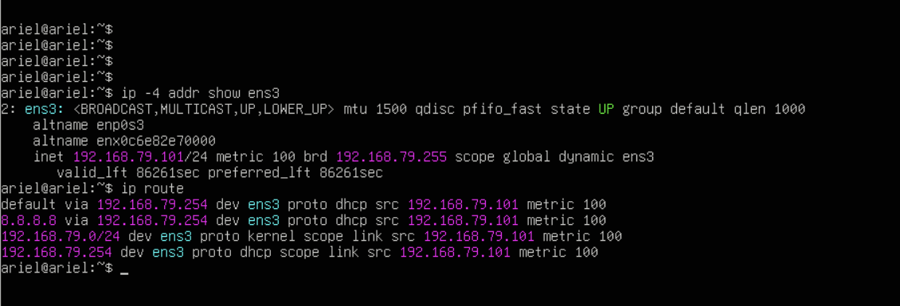
</p>

### Panel de monitoreo

El frontend se consultó desde Windows en `http://192.168.79.101/zabbix/` durante la última validación.

<p align="center">
  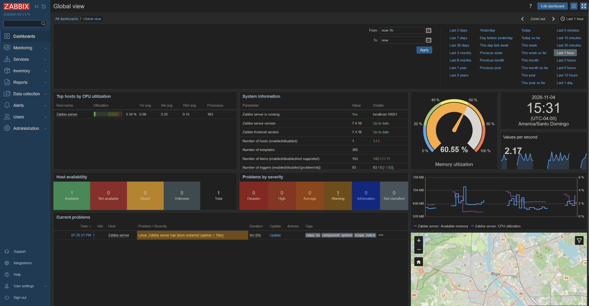
</p>

### Hosts SNMP configurados

Ambos se agregaron mediante la plantilla **Cisco IOS by SNMP** y comunidad **ZABBIX-RO**.

<p align="center">
  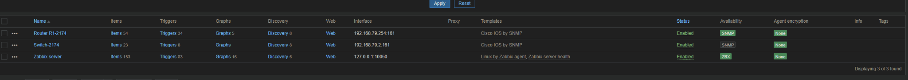
</p>

### Métricas SNMP del Router
<p align="center">
  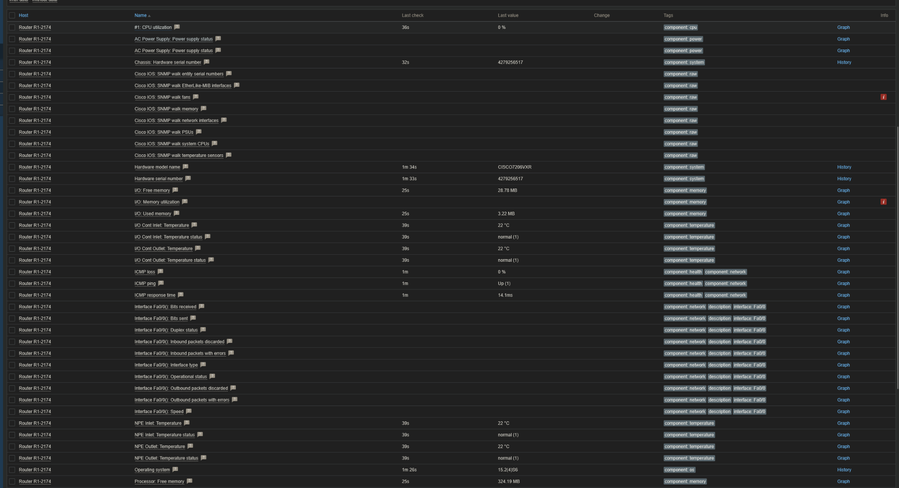
</p>

### Métricas SNMP del Switch
<p align="center">
  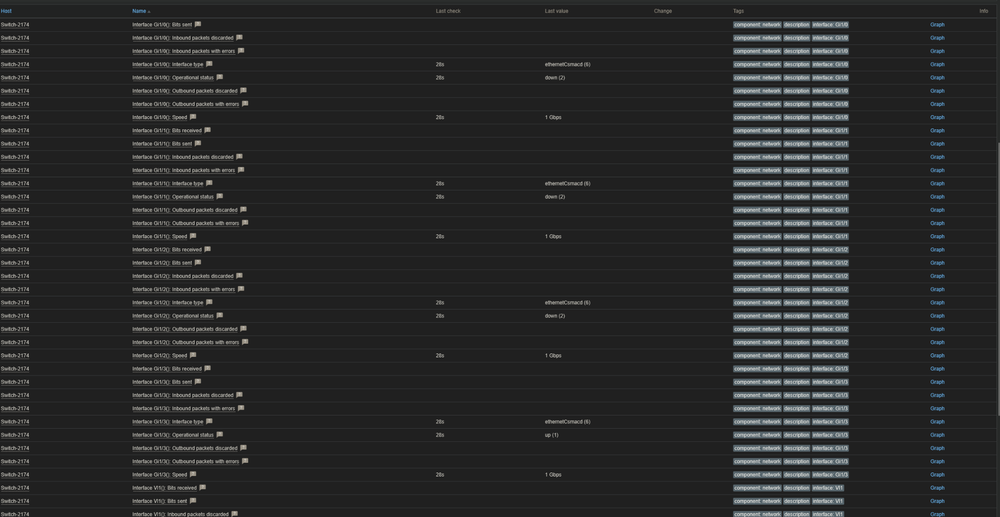
</p>
<p align="center">
  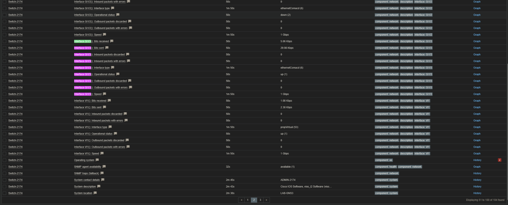
</p>

---

## 🧪 Validación de la implementación

| Verificación | Resultado |
|---|---|
| Pool LAN-ZABBIX | Configurado en el router, con concesiones registradas |
| VLAN 1 en Switch | Dirección `192.168.79.2`, `up/up` |
| SNMP Router y Switch | Comunidad `ZABBIX-RO RO` presente en las running-configs |
| DHCP Ubuntu | Dirección dinámica `192.168.79.101`, gateway `192.168.79.254` |
| Zabbix Router | CPU, memoria, temperatura e ICMP con valores recientes |
| Zabbix Switch | Disponibilidad de SNMP, tráfico, estado y velocidad de puertos |
| Windows a frontend | Panel Zabbix accesible mediante Cloud1 y VMnet1 |

---

## 📸 Capturas de pantalla

Todas las evidencias utilizadas en la documentación se encuentran en el directorio `images/`, con nombres descriptivos y numeración consistente.

```text
images/
├── 00_mapa_interactivo_preview.png
├── 00_diagrama_topologia.png
├── 01_topologia_final.png
├── 02_router_direccionamiento.png
├── 03_router_dhcp_pool_y_binding.png
├── 04_switch_direccionamiento.png
├── 05_router_snmp_comunidad.png
├── 06_switch_snmp_comunidad.png
├── 07_vmware_vmnet1_dhcp_desactivado.png
├── 08_ubuntu_cliente_dhcp.png
├── 09_zabbix_servidor_activo.png
├── 10_zabbix_hosts_router_switch.png
├── 11_zabbix_router_datos_snmp.png
├── 12_zabbix_switch_datos_snmp.png
├── 13_zabbix_switch_snmp_detalle.png
├── 14_router_snmp_read_only.png
└── 15_switch_snmp_read_only.png
```

---

## 📁 Archivos del repositorio

```text
SR-ASIGNACION-3/
├── README.md
├── .github/workflows/pages.yml
├── index.html             # Acceso principal al mapa interactivo
├── mapa-interactivo.html  # Copia del mapa interactivo
├── images/
│   └── diagramas y capturas de evidencia
├── files/
│   ├── R1-2174-running-config.txt
│   └── Switch-2174-running-config.txt
└── scripts/
    ├── 00-router-configuracion.txt
    ├── 01-switch-configuracion.txt
    ├── 02-ubuntu-netplan.yaml
    └── 03-zabbix-comandos-instalacion.sh
```

### Running-configs

[Ver configuración del Router R1-2174](files/R1-2174-running-config.txt)

[Ver configuración del Switch-2174](files/Switch-2174-running-config.txt)

### Comandos y scripts documentados

[Configuración del Router](scripts/00-router-configuracion.txt) · [Configuración del Switch](scripts/01-switch-configuracion.txt) · [Netplan Ubuntu](scripts/02-ubuntu-netplan.yaml) · [Referencia de instalación Zabbix](scripts/03-zabbix-comandos-instalacion.sh)

El archivo de instalación recoge los comandos para reproducir la configuración; no sustituye los running-configs ni contiene contraseñas.

---

## ⚠️ Limitaciones observadas

La plantilla **Cisco IOS by SNMP** incluye consultas a OID de sensores físicos que no son implementados por la imagen virtual IOSv-L2. Estos ítems pueden señalar **No Such Object available on this agent at this OID**, aunque los ítems de interfaces y disponibilidad SNMP sí se reciben correctamente.

La comunidad SNMPv2c ofrece permisos de solo lectura, pero no cifrado; el laboratorio opera en un entorno virtual aislado.

---

## ✅ Estado final del proyecto

La configuración y las validaciones principales se completaron. El Router entrega direcciones por DHCP, Ubuntu utiliza DHCP como cliente, ambos equipos Cisco exponen SNMP de solo lectura y Zabbix muestra datos operativos recientes del Router y del Switch. Las capturas y running-configs están organizados para inspección desde GitHub.
